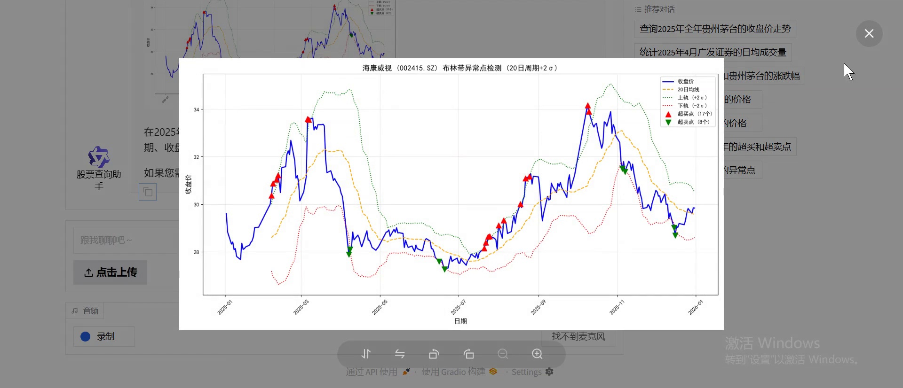

# SimonLecake · AI 应用作品集

### 从业务问题出发，让 AI 进入可用、可检查的工作流程。

LLM 评估 · 检索增强生成 · 数据分析 Agent · 计算机视觉

**简体中文** · [English](README_EN.md) · [GitHub 主页](https://github.com/SimonLecake)

## 四个项目，四种应用场景

我的实践关注 AI 应用中的完整链路：理解业务要求、选择模型与工具、组织数据、交付交互界面，并为结果设计验证与人工反馈机制。

| 项目 | 解决什么问题 | 代表性设计 | 项目介绍 |
| --- | --- | --- | --- |
| **JD Evaluation Calibrator** | 模型误读招聘要求，人工与 AI 判断不一致 | 17 类误判归纳、规则校准、样本回测 | [查看案例 →](projects/jd-evaluation-calibrator.md) |
| **Bilibili Knowledge Assistant** | 视频和笔记难以积累、查找与综合使用 | 视频转写、文档入库、多查询 RAG 与排序融合 | [查看案例 →](projects/bilibili-knowledge-assistant.md) |
| **ChatBI Stock Assistant** | 一个数据问题需要手动写 SQL、算指标、画图 | 自然语言查询、三个分析工具、只读数据访问 | [查看案例 →](projects/chatbi-stock-assistant.md) |
| **Steel Defect Inspection** | 检测结果与人工复核、问题样本整理脱节 | YOLO / VLM 双路线、检测记录、审核与导出 | [查看案例 →](projects/steel-defect-inspection.md) |

## 看实际操作

三段作者实录，点击封面或“观看演示”进入对应案例的播放器。画面展示实际操作与结果，详细技术说明保留在各案例中。

| 钢铁缺陷检测 | B 站知识库助手 | 股票数据分析助手 |
| :---: | :---: | :---: |
|  |  |  |
| **03:10** · [▶ 观看演示](projects/steel-defect-inspection.md#实机演示) | **04:05** · [▶ 观看演示](projects/bilibili-knowledge-assistant.md#实机演示) | **01:41** · [▶ 观看演示](projects/chatbi-stock-assistant.md#实机演示) |
| 双引擎检测 → 审核 → 导出 | 视频处理 → 总结入库 → 问答 | 自然语言 → 分析工具 → 表格与图表 |

录屏与架构图、合成数据图分别标注；演示不等于独立的模型效果评测。

## 这些项目体现了什么

| 能力 | 在项目中的体现 |
| --- | --- |
| **把业务规则写清楚** | 将招聘要求拆解为可执行的判断边界，区分加分项与否决条件 |
| **把模型接入完整流程** | 串联转写、检索、数据库查询、分析工具和可交互界面 |
| **让结果可以检查** | 保留资料来源、结构化结果、检测记录与人工复核入口 |
| **理解工程取舍** | 权衡本地存储、服务调用、只读约束、检索策略与运行成本 |
| **区分实现与效果** | 分别说明工程测试、模型质量、历史记录和待验证方案 |

JD 项目重点展示评估流程设计；Bilibili 与 ChatBI 展示应用实现与集成；钢铁质检基于既有学习实战材料整理，重点展示工程梳理、适配与验证。各案例均说明贡献范围与当前边界。

## 如何阅读与交流

- **快速浏览：** 先看上方项目表，再选择与你关注的方向最相关的案例。
- **技术交流：** 每篇案例都有价值说明、架构图、关键取舍与验证范围。
- **深入评审：** 可通过简历或申请材料中的联系方式安排演示；源码访问按项目情况另行安排。

本仓库为公开作品集，仅包含项目介绍与展示素材。四个项目的完整实现均保留在私有仓库，公开页面不提供源码、完整 Skill、模型权重或业务数据。[展示范围与素材说明](PUBLICATION.md)
