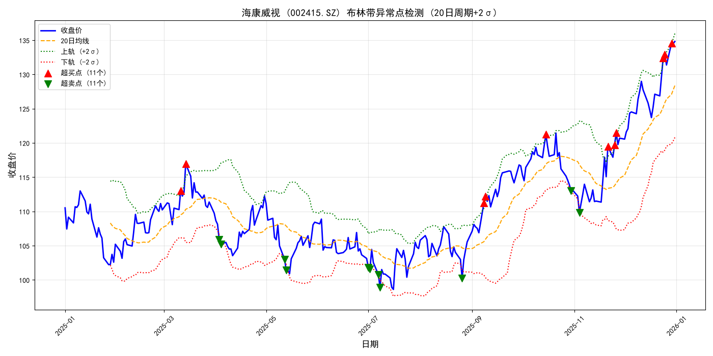
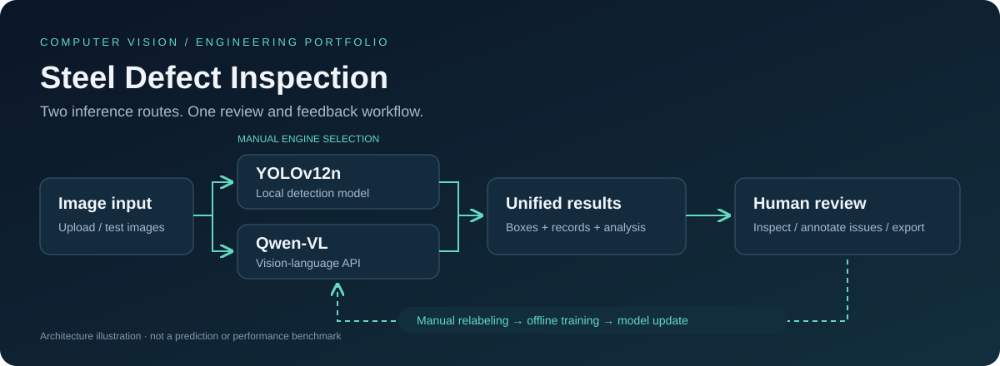

# SimonLecake · AI Application Portfolio

### Turning business problems into usable, inspectable AI workflows.

LLM Evaluation · Retrieval-Augmented Generation · Analytics Agents · Computer Vision

[简体中文](README.md) · **English** · [GitHub profile](https://github.com/SimonLecake)

## Four projects, four application contexts

My work focuses on the full application workflow: understanding requirements, selecting models and tools, organizing data, building interfaces, and designing verification and human feedback around the results.

| Project | Problem | Representative design | Case study |
| --- | --- | --- | --- |
| **JD Evaluation Calibrator** | AI and human reviewers interpret hiring requirements differently | 17 error patterns, criteria calibration and sample-based review | [Explore →](projects/jd-evaluation-calibrator.en.md) |
| **Bilibili Knowledge Assistant** | Videos and notes are difficult to search and reuse together | Transcription, document ingestion, multi-query RAG and rank fusion | [Explore →](projects/bilibili-knowledge-assistant.en.md) |
| **ChatBI Stock Assistant** | Answering a data question requires SQL, calculations and charts | Natural-language queries, three analysis tools and read-only data access | [Explore →](projects/chatbi-stock-assistant.en.md) |
| **Steel Defect Inspection** | Detection is disconnected from review and error-case collection | YOLO / VLM alternatives, inspection records, review and export | [Explore →](projects/steel-defect-inspection.en.md) |

## A closer look at two projects

### ChatBI · Analysis tool output

**ChatBI: from a historical series to an inspectable indicator chart.** The application's analysis tool generated the chart below, showing closing prices, Bollinger Bands and band crossings.

> The chart uses **synthetic data generated with a fixed random seed**, not real market prices. It demonstrates an analysis tool's output, not natural-language accuracy or investment performance. Chart labels are in Chinese.

[Explore the tool workflow and more outputs →](projects/chatbi-stock-assistant.en.md)

### Steel inspection · What happens after detection

The diagram shows the workbench workflow: upload an image, select an engine, inspect the result, record a human judgment and export error cases. It is an architectural illustration, not a detection screenshot.

[Explore the five workbench tabs and walkthrough →](projects/steel-defect-inspection.en.md)

## What the projects demonstrate

| Capability | Evidence in the projects |
| --- | --- |
| **Clarifying business rules** | Turning hiring requirements into explicit criteria, separating preferences from rejection conditions |
| **Building complete workflows** | Connecting transcription, retrieval, database queries, analysis tools and user interfaces |
| **Making results inspectable** | Preserving source information, structured outputs, inspection records and human review |
| **Reasoning about engineering choices** | Balancing local storage, service calls, read-only access, retrieval strategies and operating costs |
| **Separating implementation from effectiveness** | Distinguishing engineering checks, model quality, historical observations and proposed work |

The JD project emphasizes evaluation workflow design. Bilibili and ChatBI emphasize application implementation and integration. Steel inspection builds on existing learning materials and highlights engineering organization, adaptation and verification. Each case describes its contribution scope and limitations.

## Reading and technical discussion

- **Quick review:** choose a case from the project table that matches your interests.
- **Technical review:** each case includes its value, architecture, design choices and verification scope.
- **Further discussion:** use the contact details in my CV or application materials to arrange a demonstration. Source access can be considered individually.

This public repository contains project descriptions and presentation assets. The four full implementations remain in private repositories. It does not distribute application source, complete Skills, model weights or business data. [Publication scope and asset notes](PUBLICATION.md)
