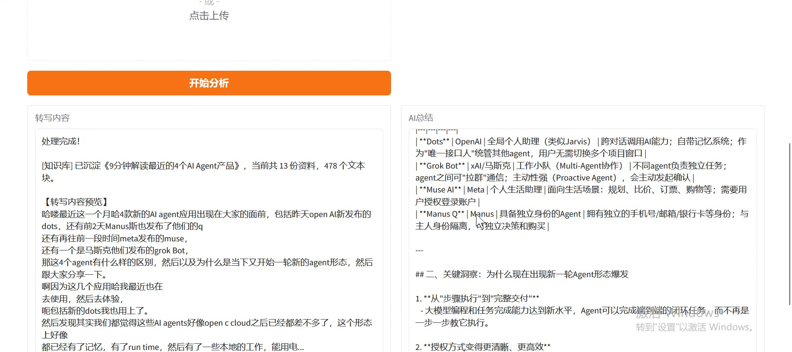
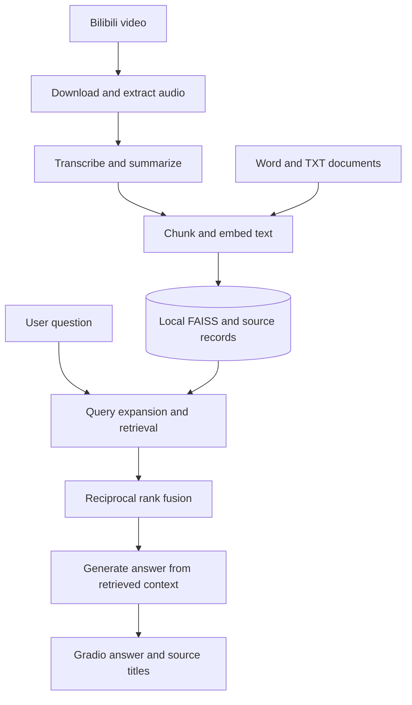

[← Portfolio](../README_EN.md) · [简体中文](bilibili-knowledge-assistant.md) · **English** · [Public source repository ↗](https://github.com/SimonLecake/bilibili-knowledge-assistant)

# Bilibili Knowledge Assistant

### Watch once. Ask again, across your collection.

Turning video audio and local documents into a personal knowledge base that can be searched, summarized and reused.

**Stack:** Python · Gradio · Speech transcription · FAISS · Multi-query RAG · RRF

## Recorded demo

**04:05** · Play inline or use the player's fullscreen control.

Start with a video URL, follow download and transcription, inspect the summary and ingestion result, then ask a knowledge-base question and review the answer and sources.

https://github.com/user-attachments/assets/9920a8df-6ac5-4cde-8612-86511bfe3530

**Approximate chapters:** `00:00` URL and content processing · `01:45` Transcript and summary · `02:00` Knowledge-base question · `03:40` Answer and sources

Expand a screenshot from the recording

Captured from the author-provided recording. The application interface is in Chinese.

Processing waits and the answer's evidence limitations are retained. Third-party video content and model-generated text demonstrate the processing workflow; they are not endorsed factual claims or a QA-quality benchmark.

## Why it exists

Saving a video is easy; finding a specific idea later is harder. Individual summaries help with browsing, but questions spanning videos and personal notes still require manual searching. This application connects content acquisition, knowledge storage and question answering.

| Scenario | Application output |
| --- | --- |
| Understand a long video quickly | Transcript, key-point summary and Word report |
| Use course material alongside personal notes | Unified ingestion of video transcripts and Word / TXT documents |
| Ask a question across sources | Multi-query retrieval, rank fusion, a synthesized answer and source titles |

**Illustrative task:** ingest notes on course review and hands-on projects, then ask how to combine the two learning methods. This is a usage example, not a measured answer-quality result.

## From input to output: three tabs

| Tab | Input | Output |
| --- | --- | --- |
| Video analysis | A Bilibili video URL | Transcript, summary, TXT / Word reports and content stored in the knowledge base |
| Document ingestion | Word / TXT files, titles and source identifiers | Document content searchable alongside video material |
| Knowledge-base QA | A question and the desired number of reference chunks | A synthesized answer and relevant source titles |

A typical session starts with analyzing a course video, adds personal project notes, then uses the QA tab to find related content across both. Users do not need to manually transfer transcripts, build vector indexes or combine search results between tools.

Content persists locally across sessions. Reingesting the same source updates its records. Answers currently display source titles; precise evidence excerpts and video timestamp navigation remain future work.

## Architecture

Content processing uses yt-dlp, FFmpeg and python-docx. Transcription, generation and embeddings connect to iFlytek, a configurable chat model and DashScope. Python orchestrates the workflow. Indexes and text are stored locally, while model processing uses external services.

| Layer | Technology and responsibility |
| --- | --- |
| Interaction and orchestration | Gradio and Python: three tabs, progress updates and service calls |
| Content processing | yt-dlp, FFmpeg and python-docx: audio acquisition, document reading and report generation |
| Model services | iFlytek transcription, chat-model summaries and answers, and DashScope embeddings |
| Retrieval and storage | FAISS, JSON and RRF: vector search, persistent source records and multi-query fusion |

## Implementation focus and choices

- **Retrieval:** retrieve for the original question and its expansions, then apply reciprocal rank fusion before selecting the final context. This lets expanded queries contribute instead of losing their results to an early cutoff.
- **Source organization:** retain transcripts, summaries and metadata separately so both detail and overviews remain searchable, with source associations preserved.
- **Repeated ingestion:** replace an existing source's chunks and vectors rather than repeatedly growing the knowledge base with duplicates.
- **Lightweight storage:** use local FAISS and JSON for personal deployment and portability, accepting limitations around large-scale concurrent writes.

My work focuses on integrating video processing with knowledge-base QA, implementing the interface, improving retrieval and source-update behavior, and establishing offline regression checks for those behaviors.

## Verification and limitations

| Available evidence | What it does not establish |
| --- | --- |
| Offline regression checks for fusion, source replacement, index reload and error handling | Answer accuracy on real questions |
| An implemented content-to-answer workflow | Reliable processing of every video or continuous external-service availability |
| Stored source information and displayed titles | Sentence-level citations, timestamp navigation or reliable abstention |

The current system analyzes audio transcripts, not video frames or screen actions. QA is single-turn. Priorities include visible evidence excerpts, an independently labeled evaluation set and better handling of questions without supporting evidence.

---

Implementation code and setup instructions are available in the [public project repository](https://github.com/SimonLecake/bilibili-knowledge-assistant). Personal corpora, cookies, indexes and generated reports are excluded. [Publication scope](../PUBLICATION.md)
