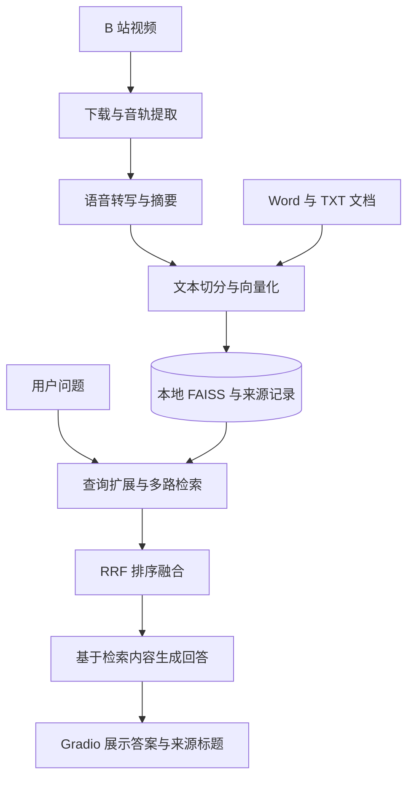

[← 作品集首页](../README.md) · **简体中文** · [English](bilibili-knowledge-assistant.en.md)

# Bilibili Knowledge Assistant

### 从一次观看，到反复提问。

把视频音轨与本地文档转化为可检索、可总结、可复用的个人知识库。

**技术：** Python · Gradio · 语音转写 · FAISS · 多查询 RAG · RRF

## 为什么做

收藏视频方便，重新找到某个观点却很难。单篇摘要帮助浏览，但跨视频、跨笔记的问题仍需要人工翻找资料。本项目把内容获取、资料沉淀与按需提问连接起来。

| 使用场景 | 应用交付 |
| --- | --- |
| 快速了解一段长视频 | 音轨转写、要点总结与 Word 报告 |
| 将课程内容与个人笔记一起使用 | 视频转写与 Word / TXT 文档统一入库 |
| 查询跨资料的问题 | 多查询检索、融合排序、综合回答与来源标题 |

**示例任务：** 将“课程复盘方法”和“项目实践笔记”放入知识库，提问“如何把课程复盘与动手做项目结合起来？”。这是说明性使用场景，本页没有将示例回答作为质量评测结果。

## 从输入到结果：三个功能页

| 功能页 | 你提供什么 | 你会得到什么 |
| --- | --- | --- |
| 视频分析 | 一个 B 站视频链接 | 音轨转写、要点总结、TXT / Word 报告，并将内容沉淀到知识库 |
| 文档沉淀 | Word / TXT 文件、标题与来源标识 | 可与视频资料一起检索的文档内容 |
| 知识库问答 | 问题与参考片段数量 | 综合回答及相关来源标题 |

一次典型使用可以是：先分析一节课程视频，再加入自己的实践笔记，最后从问答页查找两份资料中的相关内容。用户不需要在不同工具之间手动复制转写、建立向量索引或拼接检索结果。

内容会跨会话保存在本地知识库；重复导入同一来源会更新对应资料。当前回答显示来源标题，精确证据片段和视频时间跳转仍是后续方向。

## 技术架构

内容处理使用 yt-dlp、FFmpeg 与 python-docx；转写、生成与向量化分别连接讯飞、可配置聊天模型与 DashScope。应用由 Python 固定流程编排，本地保存索引和文本，模型处理仍依赖外部服务。

| 层次 | 技术与职责 |
| --- | --- |
| 交互与编排 | Gradio 与 Python：组织三个功能页、进度反馈和服务调用 |
| 内容处理 | yt-dlp、FFmpeg、python-docx：音轨获取、文档读取与报告生成 |
| 模型服务 | 讯飞转写、聊天模型总结与回答、DashScope 文本向量化 |
| 检索与存储 | FAISS、JSON 与 RRF：向量召回、来源持久化及多查询融合 |

## 实践重点与关键取舍

- **检索策略：** 原问题和扩展问题分别召回，再用 RRF 融合排名后选取上下文，避免前一路结果提前占满名额。
- **资料组织：** 分开保存原始转写、摘要与元数据，让细节和概括都可被检索，并保留来源归属。
- **重复更新：** 同一来源再次入库时替换对应内容与向量，防止知识库因重复上传持续膨胀。
- **轻量部署：** 选择本地 FAISS 与 JSON，便于个人使用与迁移；代价是尚不适合大规模并发写入。

我的实践重点是整合视频处理与知识库问答流程、实现交互入口、完善检索与重复来源更新逻辑，并为这些行为建立离线回归检查。

## 验证与当前边界

| 已有依据 | 尚不能据此证明 |
| --- | --- |
| 离线回归覆盖多查询融合、来源替换、索引重载和异常处理 | 真实问题的回答准确率 |
| 已实现从内容处理到问答的应用流程 | 任意视频都可稳定处理，或外部服务始终可用 |
| 保留来源信息并展示标题 | 已具备逐句引用、视频时间跳转或可靠拒答 |

当前分析的是视频音轨文本，不理解画面与屏幕操作；问答为单轮模式。下一步优先补充证据片段展示、独立标注评测集与无答案判断。

---

完整实现、个人语料、Cookies、索引与运行报告均不在本展示仓库中。[展示范围](../PUBLICATION.md)
