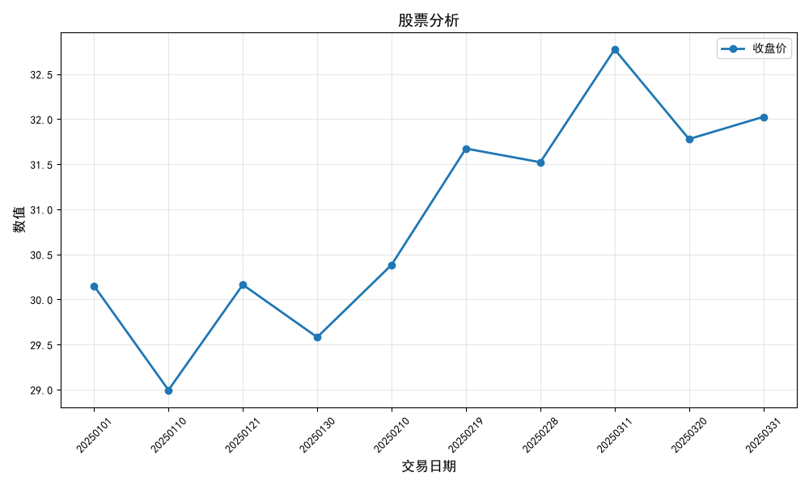
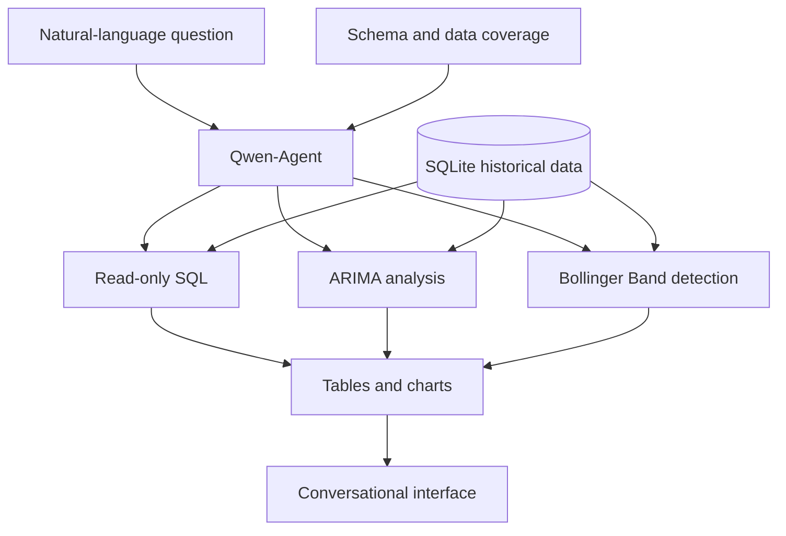

[← Portfolio](../README_EN.md) · [简体中文](chatbi-stock-assistant.md) · **English**

# ChatBI Stock Assistant

### One question, connected to queries, analysis and charts.

A historical stock-data prototype where an agent interprets natural-language questions, databases and analysis tools perform calculations, and users receive inspectable tables and charts.

**Stack:** Python · Qwen-Agent · SQLite · Pandas · Statsmodels · Matplotlib · Gradio

## See an output first

The application's Bollinger Band tool generated this chart of closing prices, rolling averages, bands and crossings.

> **All charts use synthetic data generated with a fixed random seed.** Stock names illustrate entity mapping, not the actual prices of those stocks. “Overbought / oversold” labels describe the indicator, not trading recommendations. Chart labels are in Chinese.

View SQL query and ARIMA tool outputs

**SQL query chart.** Dates and closing prices returned by a query are visualized. The current general-purpose query chart samples at most 10 points.

**ARIMA demonstration.** A historical sequence is extrapolated for seven subsequent weekdays. Rolling backtests and forecast-error evaluation have not been completed.

## The problem

A question about a trend usually requires writing SQL, organizing results, calculating indicators and plotting. This project connects those steps through a single conversational entry point.

| Example request | Tool responsibility | Inspectable output |
| --- | --- | --- |
| “Show Kweichow Moutai's closing-price trend for January 2025” | Read-only SQL query | Data table, descriptive statistics and chart |
| “Using the latest database records, forecast Wuliangye's next seven weekdays” | ARIMA modeling | Historical and extrapolated curves, plus values |
| “Find Hikvision's Bollinger Band crossings in 2025” | Rolling calculations and filtering | Dates, prices, band values and deviations |

These are example entry points. The images above come from direct offline tool calls, not an evaluated end-to-end natural-language conversation.

A conversation follows this sequence: **ask a question → the agent identifies the stock, period and analysis task → a tool runs → inspect text, tables and charts**. SQL retrieves data and analysis tools perform calculations, with returned tables available for checking. The interface uses Qwen-Agent WebUI / Gradio for conversational analysis.

## Architecture

The model interprets questions, generates SQL and selects tools. The database and Python tools execute queries and calculations. Separate market-data and synthetic-data preparation paths support experiments with real data and tool demonstrations without model API credentials.

## Implementation focus and choices

- **Explicit tool contracts:** register querying, sequence extrapolation and indicator detection as three tools with defined parameters and outputs.
- **Restricted data access:** use SQLite read-only mode and an authorization callback to reject writes and database attachment. Read-only access does not guarantee correct SQL semantics.
- **Visible date boundaries:** provide the agent with date formatting and dataset coverage to reduce confusion between historical and live data.
- **Repeatable demonstrations:** use a fixed seed and temporary database to demonstrate all three tools' calculations and charts.

My work focuses on integrating Qwen-Agent with the analysis tools, preparing data, constraining database access, visualizing results, and building offline demonstrations and data-layer checks.

## Verification and limitations

Data-layer checks cover deterministic synthetic data, uniqueness constraints, protection of existing databases and read-only access. The offline demonstration generates charts and Markdown results for all three tools.

There is no systematic natural-language-to-reference-SQL evaluation set yet. ARIMA uses fixed parameters and has no forecast-performance benchmark. Dates follow weekdays rather than an exchange holiday calendar. This is a personal prototype; multi-user authorization, query timeouts and production monitoring remain future work.

Priorities are a question–SQL–result evaluation set, consistent metric definitions and error recovery, followed by combined document retrieval and structured-data answers.

---

This page shares synthetic-data charts and an architectural overview, not source code, market databases or credentials. [Publication scope and image provenance](../PUBLICATION.md)
