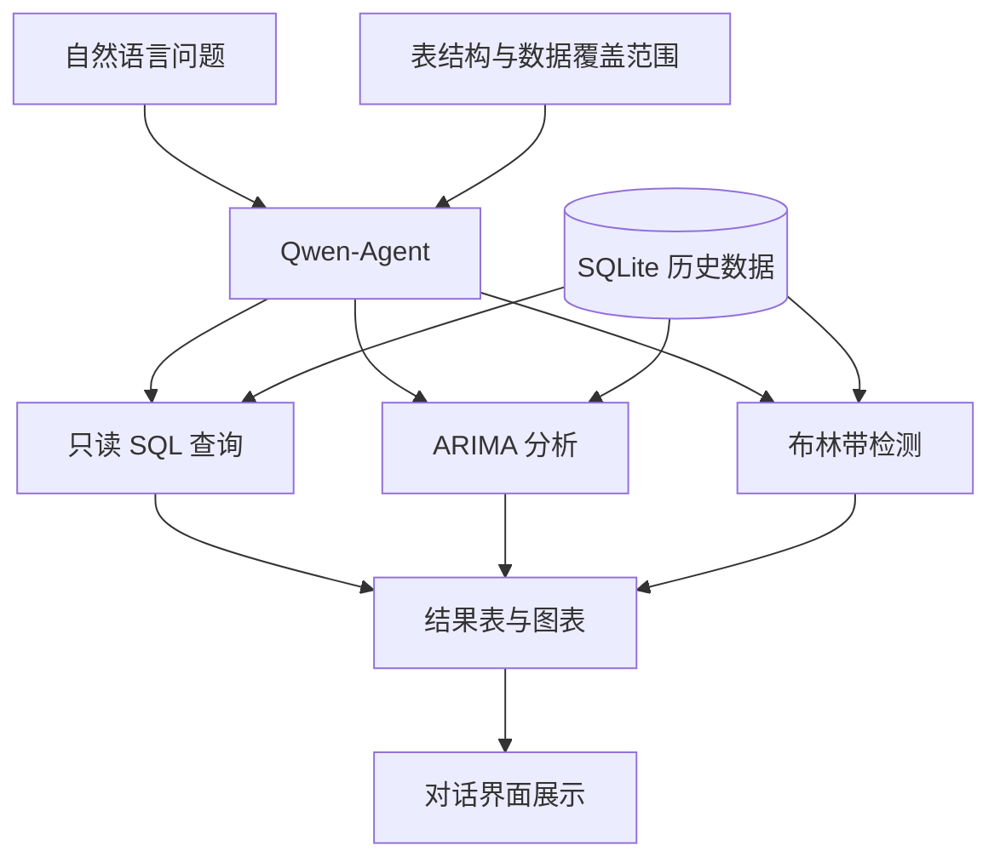

[← 作品集首页](../README.md) · **简体中文** · [English](chatbi-stock-assistant.en.md)

# ChatBI Stock Assistant

### 用一句问题，连接数据查询、分析与图表。

以历史股票数据为场景，将自然语言问题交给 Agent，由数据库与分析工具完成计算，返回可检查的表格和图表。

**技术：** Python · Qwen-Agent · SQLite · Pandas · Statsmodels · Matplotlib · Gradio

## 先看输出

下图由项目的布林带分析工具实际生成，展示收盘价、滚动均值、上下轨与突破点。

> **全部图表使用固定随机种子生成的合成数据。** 股票名称用于演示实体映射，不代表对应股票的真实走势。图中的“超买 / 超卖”是指标标签，不是交易建议。

查看 SQL 查询与 ARIMA 工具输出

**SQL 查询结果图。** 根据查询返回的日期与收盘价生成可视化；当前通用查询图最多采样 10 个点。

**ARIMA 方法演示。** 根据历史序列外推后续 7 个工作日；尚未进行滚动回测或误差评估。

## 解决什么问题

一个“某段时间的走势如何”的问题，通常需要写 SQL、整理结果、计算指标和绘图。本项目将这些环节连接到同一对话入口。

| 示例问题 | 工具负责什么 | 可检查的输出 |
| --- | --- | --- |
| 查询某只股票一个季度的收盘价 | 只读 SQL 查询 | 数据表、描述统计与图表 |
| 查看历史序列之后 7 个工作日的模型外推 | ARIMA 时间序列建模 | 历史与外推曲线、数值表 |
| 找出一年内突破布林带的日期 | 滚动指标计算与筛选 | 日期、价格、轨道值与偏离比例 |

这些是使用入口。上方图片来自离线直接调用工具，不代表整段自然语言对话已经通过准确率评测。

## 技术架构

模型理解问题、生成 SQL 并选择工具；数据库和 Python 程序执行查询与计算。行情接入与固定种子合成数据两条准备路径，分别支持真实数据实验和无需模型密钥的工具演示。

## 实践重点与关键取舍

- **明确工具边界：** 将查询、序列外推和指标检测注册为三个工具，给出明确参数与输出。
- **约束数据访问：** 使用 SQLite 只读模式与授权回调，拒绝写入、附加数据库等操作；只读约束不能保证 SQL 语义正确。
- **减少时间范围误读：** 向 Agent 提供日期格式与数据覆盖区间，避免把历史库当成实时行情。
- **保留可复现演示：** 使用固定种子与临时数据库，演示三个工具的计算与图表输出。

我的实践重点是 Qwen-Agent 与分析工具的集成、数据准备与只读访问约束、结果可视化，以及离线演示和数据层检查。

## 验证与当前边界

数据层检查覆盖合成数据可复现、唯一约束、已有数据库保护和只读访问；离线演示实际生成三个工具的图表与 Markdown 输出。

当前没有自然语言问题与参考 SQL 的系统评测集；ARIMA 使用固定参数，尚无预测效果基准；日期按工作日生成，未对齐交易所节假日。应用定位为个人分析原型，多用户权限、查询超时和生产监控仍待完善。

后续优先建立问题—SQL—结果评测集，完善指标口径和错误恢复，再扩展文档检索与结构化数据联合回答。

---

本页展示合成数据图表与架构概述，不分发源码、行情数据库或密钥。[展示范围与图片来源](../PUBLICATION.md)
