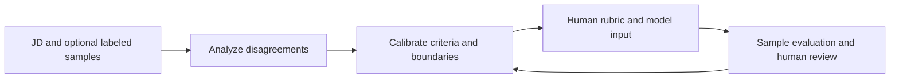

[← Portfolio](../README_EN.md) · [简体中文](jd-evaluation-calibrator.md) · **English** · [Public source repository ↗](https://github.com/SimonLecake/jd-rewrite-skill)

# JD Evaluation Calibrator

### Improve the criteria when the model cannot be changed.

Turning ambiguous job descriptions into explicit evaluation rules so that human reviewers and AI can apply more consistent hiring criteria.

**Focus:** LLM evaluation, business rules and human feedback · **Format:** Host-executed Skill v4.1.0

## The value, in two examples

| Original wording | Potential misinterpretation | Calibrated boundary |
| --- | --- | --- |
| “Knowledge-base project experience preferred” | Reject candidates without that experience | Treat it as a bonus, not a standalone rejection condition |
| “Proficient in tools such as Markdown and Notion” | Recognize only the named tools | Accept evidence of equivalent tasks completed with other tools |

*These are manually written illustrations, not measured model outputs or the complete rule library.*

When model weights and system prompts are frozen, teams may only be able to edit the job-description input. Clarifying requirements, specifying decision boundaries and reviewing labeled examples still provides a practical way to improve how the criteria are applied.

## Workflow

| Mode | Input | Deliverables |
| --- | --- | --- |
| Sample-based calibration | JD, historical samples and human judgments | Rubric, evidence matrix, evaluation records and model input text |
| JD-only rewriting | JD | Ambiguity diagnosis, provisional rules and input text awaiting evaluation |

## What the user receives

The user supplies a JD and, when available, historical samples with confirmed human judgments. The deliverables help check both whether the criteria are clear and whether the model follows them:

| Deliverable | What it helps inspect |
| --- | --- |
| Revised JD | Ambiguous wording and clarified boundaries |
| Human evaluation rubric | Experience levels, mandatory requirements and bonus criteria |
| Responsibilities and requirements text | Criteria ready for the existing tool's two input fields |
| Evidence matrix and evaluation table, in sample-based mode | Human–model disagreements and whether revisions improve alignment |

Users put the two text outputs into the existing evaluation tool, rerun confirmed and sanitized samples, and inspect disagreements. JD-only outputs are explicitly marked as awaiting evaluation; generating a rule set does not establish its effectiveness.

A key design choice is to retain numerical weights in the human rubric while using qualitative levels by default in the model input. This adapts the same business requirements to two different consumers. The workflow depends on its host for model access and file handling; it is not a standalone web service.

## Contribution and practice records

As the primary contributor and evaluation workflow designer, my work covers error analysis, criteria calibration, Skill packaging, evaluation-method design, and architecture and interface feasibility analysis for a future Error Case RAG workflow.

| Record | Interpretation |
| --- | --- |
| **17 error patterns** | A catalog of recurring ways that evaluation rules can be misapplied |
| **2 operating modes** | Sample-based calibration and JD-only rewriting |
| **Human–AI agreement: 55% → 70%** | A historical observation from a specific business setting, a 15-percentage-point increase |

Agreement measures alignment between human and model judgments, not hiring quality or general accuracy. The raw data, sample size and full configuration are not public. This historical observation is not independently reproducible and does not establish a causal effect.

## Status and next steps

- **Implemented:** the Skill workflow, supporting rules and templates, and both input modes.
- **Further validation:** independent holdout performance and whether downstream parsing or truncation preserves the intended rules.
- **Proposed architecture:** retrieving past error cases to support future calibration. Error Case RAG is not implemented; the current evaluation interface lacks the required external-context injection capability.

The central capability demonstrated here is translating tacit business judgment into executable, testable criteria under constrained system access.

---

The complete Skill, prompt templates and error-pattern library are available in the [public project repository](https://github.com/SimonLecake/jd-rewrite-skill). Real business samples and raw evaluation data are not distributed. This page retains the method overview and illustrative examples. [Publication scope](../PUBLICATION.md)
