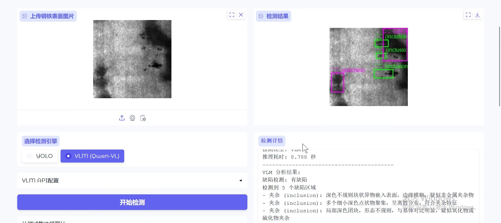
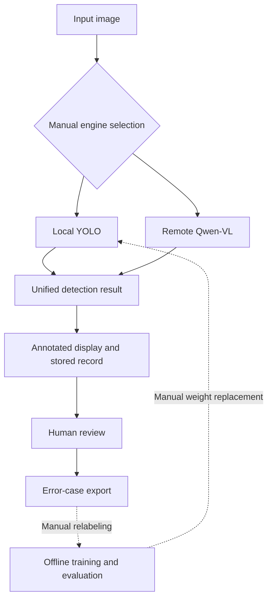

[← Portfolio](../README_EN.md) · [简体中文](steel-defect-inspection.md) · **English**

# Steel Defect Inspection

### From defect localization to human review and error-case collection.

An AI inspection workbench for steel surfaces, connecting visual detection, historical records, human review and preparation of error cases for further improvement.

**Stack:** Python · YOLO · Qwen-VL · Gradio · SQLite

## Recorded demo

**03:10** · [Open video separately](https://github.com/user-attachments/assets/d346e19f-a398-43ef-a979-c9453fc4cfad)

Upload an image, try YOLO and VLM detection, review results, inspect records, export error cases and run batch predictions.

https://github.com/user-attachments/assets/d346e19f-a398-43ef-a979-c9453fc4cfad

**Approximate chapters:** `00:00` Image and YOLO detection · `00:58` VLM detection · `01:20` Human review · `01:35` Records · `02:00` Error-case export · `02:20` Batch prediction

Expand a screenshot from the recording

Captured from the author-provided recording. The application interface is in Chinese.

The recording demonstrates the workflow and individual results, not overall detection accuracy. Human review can still identify false positives or missed defects.

*Architecture illustration retained from the original project README; this is not an actual detection result.*

## Project value

A bounding box is only the beginning of inspection. Users also need to confirm the result, find the original image and identify cases worth relabeling. This project organizes the application around those follow-up actions.

| Stage | Capability | Purpose |
| --- | --- | --- |
| Detection | Manually select local YOLO or a remote VLM | Explore two technical approaches for different scenarios |
| Records | Store predictions, image paths, elapsed time and review state | Inspect past results and trace errors |
| Review | Mark correct detections, false positives or missed defects, with notes | Preserve human judgment and collect error cases |
| Export | Package problem images, CSV records and follow-up guidance | Prepare material for manual relabeling and training |

The six defect categories are crazing, inclusion, pitted surface, scratches, patches and rolled-in scale. The application is a learning and engineering prototype.

## Using the workbench

**Upload an image → select an engine → inspect the boxes → record a review → find and export error cases.**

For example, if a reviewer sees a scratch that the model missed, they can mark the record as a missed defect and add a note. Those records can later be filtered and exported with the images for manual relabeling. This illustrates the workflow; it is not a new detection experiment.

| Tab | User action |
| --- | --- |
| Defect detection | Upload or select a test image, choose YOLO / VLM, inspect boxes and submit a review |
| Inspection records | Query past detections and review states, and revisit images |
| Statistics | View summaries of detection and review records |
| Data export | Select error cases and export images, CSV records and follow-up guidance |
| Competition submission | Generate a batch-prediction submission file once data and a model are prepared |

The workbench reviews inspection records. Editing individual bounding-box labels still requires an external annotation tool. This connects error discovery to training-data correction while preserving human confirmation.

## Architecture

*Dashed steps require human coordination. This is a workflow diagram, not an actual detection screenshot.*

YOLO performs local object detection for fixed classes. Qwen-VL receives images through a compatible API and returns structured detection information. A common result structure supports shared display, persistence and review. The engines are manually selected alternatives; automatic cascading and model voting are not implemented.

## Contribution and provenance

This project was organized from existing AI inspection learning materials and includes understanding and adapting existing code. My contribution centers on engineering organization, environment and resource guidance, batch-inference compatibility adjustments, regression checks, continuous integration and project documentation.

I do not claim original authorship of the underlying model research, third-party components or all original training-project code. The portfolio highlights understanding, adaptation and verification of the detection–review–data feedback workflow.

## Recorded verification

| Check | Recorded result | Scope |
| --- | --- | --- |
| Offline regression | Checks around coordinate parsing, persistence, statistics and export passed | Engineering behavior |
| UI construction and HTTP smoke checks | Interface construction succeeded; page and configuration endpoints were reachable | Not a browser end-to-end test |
| Local YOLO inference on one image | Returned bounding boxes and an annotated image | Inference-path validation, not overall detection quality |

These observations come from existing validation records in the private project. This showcase does not include the inference image, model weights or original experiment logs. Models were not retrained for this publication.

## Limitations and priorities

- **Feedback requires human work:** exported error cases still need corrected labels and independent evaluation of the next model.
- **Confidence values are not comparable:** the current VLM confidence field is a placeholder, not a reliability estimate.
- **Engineering and model metrics differ:** the share of reviewed records marked correct is not mAP or a production miss rate. Unreproduced historical performance figures are not presented here.
- **Next priorities:** expand independent evaluation, distinguish detection failure from no defect, and track model versions and review history.

---

This page provides an architectural and practice overview. It does not distribute original course materials, implementation code, datasets or model weights. [Publication scope and third-party notes](../PUBLICATION.md)
