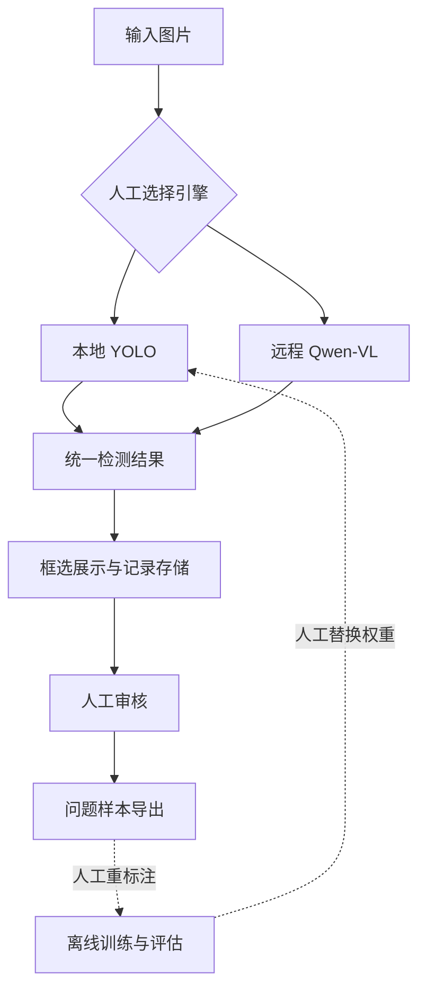

[← 作品集首页](../README.md) · **简体中文** · [English](steel-defect-inspection.en.md)

# Steel Defect Inspection

### 从缺陷定位，到人工复核，再到问题样本回流。

面向钢铁表面缺陷的 AI 质检工作台，将视觉检测、记录查询、人工审核和错误样本整理串成完整流程。

**技术：** Python · YOLO · Qwen-VL · Gradio · SQLite

## 实机演示

**03:10** · 可直接播放或全屏观看。

上传图片，分别体验 YOLO 与 VLM 检测，再完成人工审核、历史记录查询、问题样本导出和批量预测。

https://github.com/user-attachments/assets/d346e19f-a398-43ef-a979-c9453fc4cfad

**关键片段（约）:** `00:00` 图片与 YOLO 检测 · `00:58` VLM 检测 · `01:20` 人工审核 · `01:35` 历史记录 · `02:00` 问题样本导出 · `02:20` 批量预测

展开查看录屏截图

从作者提供的实际录屏中截取，保留应用画面。

录屏展示操作流程和个别样本结果，不代表整体检测准确率；人工审核仍可能标记误检或漏检。

*沿用原项目 README 的架构展示图；示意图不代表实际检测结果。*

## 项目价值

检测框只是质检流程的起点。实际使用还需要知道：这次判断是否正确、问题发生在哪张图片、哪些样本值得重新标注。本项目围绕这些后续动作组织应用。

| 环节 | 提供的能力 | 实际用途 |
| --- | --- | --- |
| 检测 | 手动选择本地 YOLO 或远程 VLM | 比较两种技术路线，验证不同场景 |
| 记录 | 保存预测、图片路径、耗时和审核状态 | 查询历史结果、回看问题 |
| 审核 | 标记正确、误检、漏检并填写备注 | 保留人工判断，积累错误案例 |
| 导出 | 整理问题图片、CSV 与后续处理说明 | 为人工重标注与训练准备材料 |

支持龟裂、夹杂、点蚀、划痕、斑块和氧化铁皮压入六类缺陷。项目定位为学习与工程实践原型。

## 在工作台里怎么用

**上传图片 → 选择引擎 → 查看检测框 → 标记审核结果 → 查找并导出问题样本。**

例如，审核者发现某张图片有划痕但模型没有框出，可以标记为“漏检”并填写备注，后续筛选这些问题记录，导出图片与记录供人工修正标注。这是使用流程说明，不是新增的检测实验。

| 功能页 | 用户可以做什么 |
| --- | --- |
| 缺陷检测 | 上传或选择测试图片，选择 YOLO / VLM，查看框选结果并审核 |
| 检测记录 | 查询历史检测与审核状态，回看对应图片 |
| 统计分析 | 查看检测与审核记录的汇总信息 |
| 数据导出 | 筛选问题样本，导出图片、CSV 和后续处理说明 |
| 竞赛提交 | 在准备好数据与模型后生成批量预测提交文件 |

工作台支持的是对检测记录的审核；逐框修改标签仍需外部标注工具。这样可以将“发现问题”和“修正训练数据”衔接起来，同时保留必要的人工确认。

## 技术架构

*图中虚线部分需要人工组织；这是流程示意图，不是检测效果截图。*

YOLO 提供针对固定类别的本地目标检测；Qwen-VL 通过兼容 API 接收图片并返回结构化检测信息。统一结果结构让展示、存储和审核复用同一套流程。目前两条路线由用户手动选择，没有自动级联或模型投票。

## 我的实践与来源说明

本项目基于既有 AI 质检学习实战材料整理，包含对已有代码的理解与适配。我的贡献集中在工程结构梳理、运行与资源准备说明、批量推理兼容性调整、基础回归检查、持续集成和项目展示文档。

底层模型研究、第三方组件及全部原始实战代码不归为个人原创。作品集重点呈现对检测—审核—数据回流流程的理解、适配与验证能力。

## 已有验证

| 检查 | 已记录的结果 | 解释范围 |
| --- | --- | --- |
| 离线回归 | 坐标解析、记录存取、统计与导出相关检查通过 | 验证工程行为 |
| 工作台构造与 HTTP 冒烟 | 界面构造成功，页面及配置接口可访问 | 不等同于浏览器端到端测试 |
| 本地 YOLO 单图推理 | 返回检测框与标注图 | 验证推理链路，不证明整体检测质量 |

上述依据来自私有项目中已有的验证记录，本展示仓库不包含用于推理的图片、模型权重或原始实验日志，也未在此次发布时重新训练模型。

## 关键边界与下一步

- **数据回流需要人工：** 导出问题样本不等于获得可信标签，仍需修正标注并独立评估新模型。
- **两种置信度不能直接比较：** 当前 VLM 置信度字段为占位值，不代表可靠性。
- **工程指标与模型指标分开：** 已审核记录中的“正确比例”不等于 mAP 或产线漏检率，本页不发布未复现的历史性能数字。
- **后续优先项：** 扩大独立评估集，区分检测失败与无缺陷，记录模型版本与审核历史。

---

本页仅展示架构与实践概述，不分发原始课程材料、实现代码、数据集或模型权重。[展示范围与第三方说明](../PUBLICATION.md)
